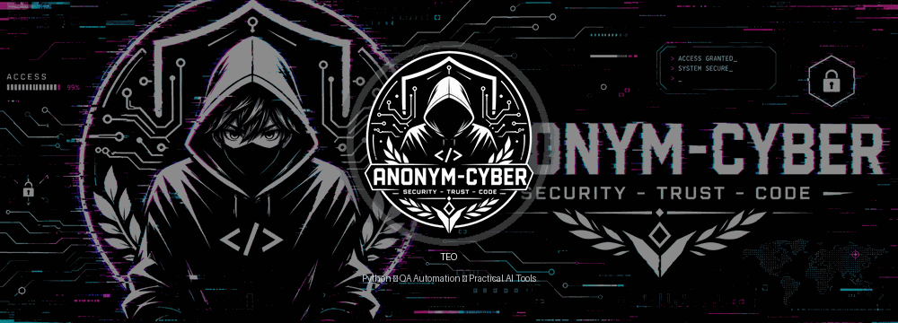
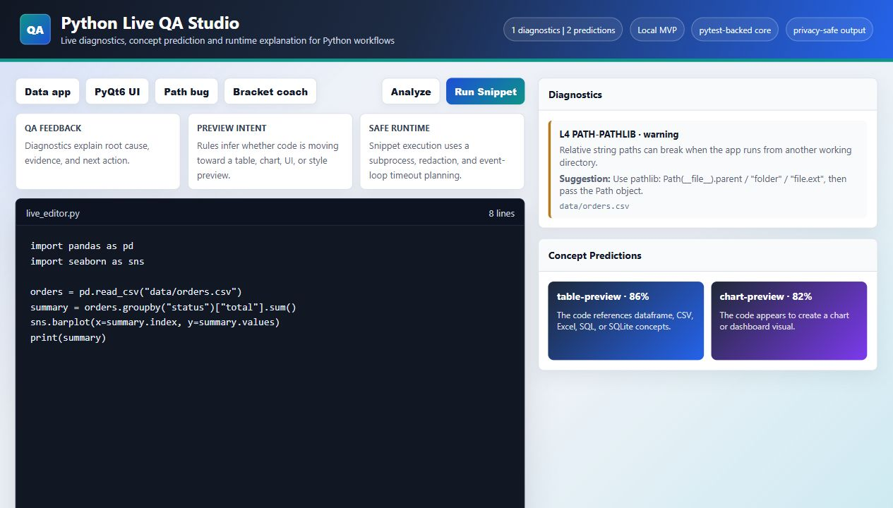
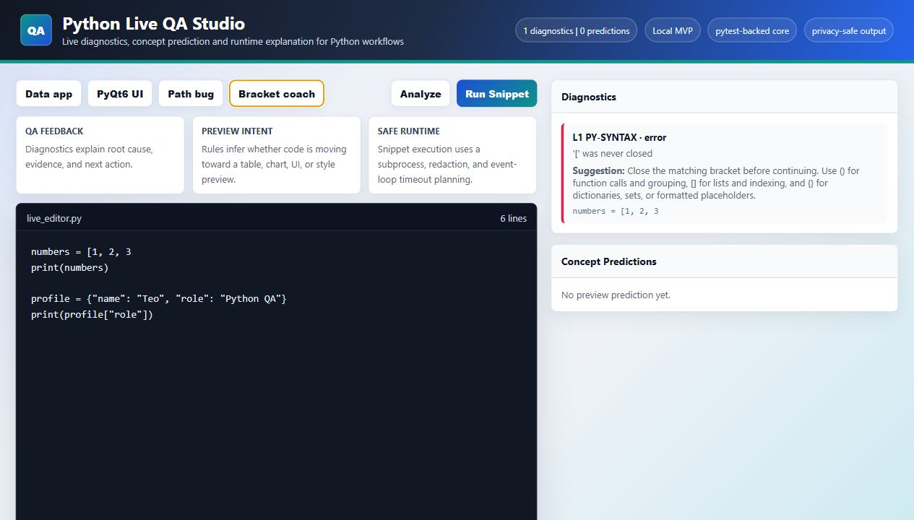
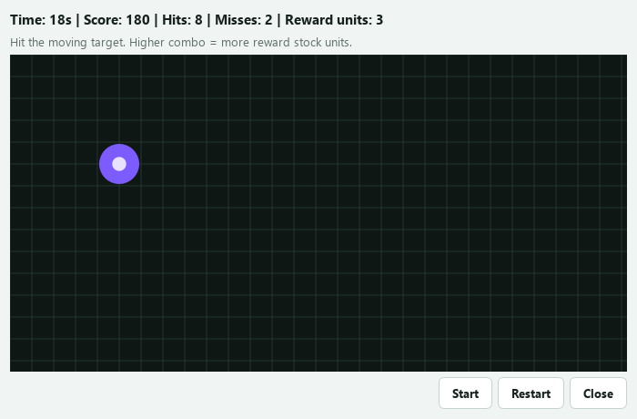
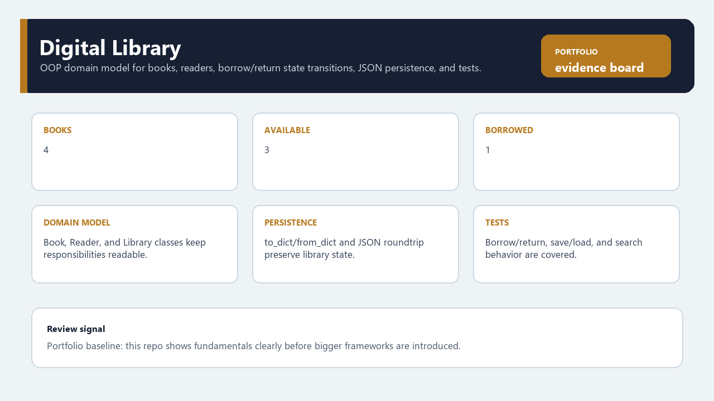
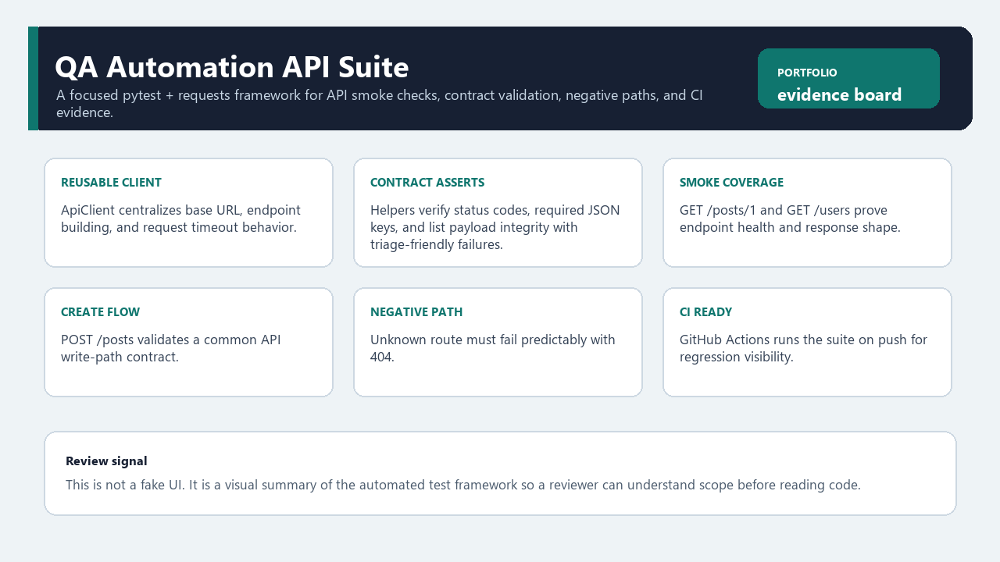

  

<h1 align="center">Hi, I'm Teo</h1>

  Python Developer graduate focused on QA automation, desktop tools, data validation, and readable Python systems.

  <a href="https://github.com/teogame3d-alt/teogame3d-alt-portfolio">Technical Portfolio</a>
  &nbsp;|&nbsp;
  <a href="https://teogame3d-site.pages.dev/">3D Portfolio</a>
  &nbsp;|&nbsp;
  <a href="https://github.com/teogame3d-alt?tab=repositories">Repositories</a>

---

## About Me

I build small but reviewable Python projects: clear domain logic, tests, CI, SQLite persistence, API checks, PyQt6 interfaces, and data-quality workflows.

My goal is to show how each application works, why the code is structured that way, and how behavior can be verified instead of guessed.

---

## Fast Review Path

For a quick technical review, I suggest this order:

1. Open [Python Live QA Studio](https://github.com/teogame3d-alt/pylive-qa-studio) for the strongest tooling/debugging direction.
2. Check [QA Automation API Suite](https://github.com/teogame3d-alt/qa-automation-api-suite) for pytest, API contracts, negative paths, and CI.
3. Review one UI/data project: [PyQt6 Magic Shop](https://github.com/teogame3d-alt/pyqt6-magic-shop), [AI Agent Text RO](https://github.com/teogame3d-alt/ai-agent-text-ro), or [Interactive Data Viz](https://github.com/teogame3d-alt/interactive-data-viz).

Each repository includes setup steps, tests, screenshots, and notes about design decisions or tradeoffs.

---

## Current Focus

- Python tooling and QA validation with `pytest`, API checks, regression thinking, and CI.
- Desktop applications with PyQt6, SQLite, service/repository layers, and testable business rules.
- Data cleaning and visualization with pandas, validation reports, and reproducible outputs.
- User-trainable AI Agent concepts where behavior stays visible through memory, rules, and tests.
- Game QA / DevQA direction with Unreal Engine interest, Python scripting, C#/.NET concepts, and 3D portfolio context.
- Public repository discipline: focused scope, screenshots, no private machine artifacts, and clear review paths.

---

## Featured Engineering Projects

| Project | What it shows |
| --- | --- |
| [Python Live QA Studio](https://github.com/teogame3d-alt/pylive-qa-studio) | Live Python diagnostics, traceback explanations, concept prediction, QA-oriented developer feedback, tests, CI |
| [AI Agent Text RO](https://github.com/teogame3d-alt/ai-agent-text-ro) | User-trainable RO/EN agent workflow, learned answers, SQLite memory, PyQt6 UI, tests, CI |
| [Interactive Data Viz](https://github.com/teogame3d-alt/interactive-data-viz) | Reproducible data cleaning, validation reports, interactive charts, algorithm visualizers |
| [PyQt6 Magic Shop](https://github.com/teogame3d-alt/pyqt6-magic-shop) | Desktop CRUD app with service/repository layers, SQLite persistence, and tested business rules |
| [Digital Library](https://github.com/teogame3d-alt/digital-library) | Compact OOP model with borrow/return state transitions, JSON persistence, and tests |
| [QA Automation API Suite](https://github.com/teogame3d-alt/qa-automation-api-suite) | API smoke tests, response contract checks, negative-path validation, GitHub Actions |

For a fuller technical review path, see the [Technical Portfolio Index](https://github.com/teogame3d-alt/teogame3d-alt-portfolio).

---

## Proof of Work

- Most Python repositories can be installed locally and checked with `python -m pytest`.
- UI projects include screenshots from the actual app flow; CLI/API projects use evidence boards plus testable code.
- Architecture and engineering notes explain why the project is scoped the way it is.
- The projects are intentionally small enough to review, but structured like systems: package code, tests, docs, runtime data kept out of Git.
- Known limits are documented instead of hidden; future work is separated from current features.

---

## Project Status Labels

- `Working repository`: source code, setup steps, tests, CI or documented validation path.
- `Local prototype`: experimental code used to test an idea before making larger claims.
- `Visual showcase`: Blender renders, animations, branding studies and presentation assets.
- `Learning baseline`: compact project used to demonstrate fundamentals such as OOP, persistence or CLI flow.

I avoid presenting concept work as finished product work. When a project is experimental, the README should say so.

---

## Visual Project Tour

These screenshots show the projects as working applications, not only repository text.

### Python Live QA Studio

Live code diagnostics, concept prediction, privacy-safe traceback output, and a learning coach for syntax concepts such as `()`, `[]`, and `{}`.

  
  

### Desktop, Data, and Text Tools

  
  
  

  
  

### QA Automation Evidence

The API suite screenshot is a technical evidence board. It summarizes the contract tests, negative-path checks, reusable client, and CI signal before a reviewer opens the code.

  
  

---

## Review Signals

- Each project is intentionally scoped so the behavior can be inspected quickly.
- READMEs focus on problem, solution, setup, tests, and design decisions.
- Tests and CI are used where repeatable behavior matters.
- Internship and Python Developer training are reflected through project structure, documentation, test strategy, and review-ready repositories.
- Public repository hygiene matters: screenshots, logs, and docs should not expose `.env` files, local machine paths, API tokens, or private environment details.
- Computer-vision or game-adjacent demos are published only as safe QA/model-evaluation work: no live input automation and no local/private artifacts.

---

## Flagship Direction

My current flagship direction is [Python Live QA Studio](https://github.com/teogame3d-alt/pylive-qa-studio): a developer tool concept that analyzes Python code while it is being written, explains errors, suggests safer implementation patterns, and predicts whether the next useful preview is a table, chart, UI window, or style update.

The goal is not to replace professional IDEs. The goal is to show debugging, testing, visual feedback, and product thinking in one inspectable workflow.

---

## Tech Stack

  
  
  
  
  
  
  
  
  

---

## How I Build

- I prefer clear behavior over black-box magic.
- I write tests for the parts that should not silently break.
- I keep projects small, documented, and easy to review.
- I care about the bridge between technical correctness and human usability.

---

## Direction

I am growing toward QA automation, Python tooling, practical desktop/data applications, and game QA/DevQA workflows.

---

## Links

- Portfolio: [teogame3d-site.pages.dev](https://teogame3d-site.pages.dev/)
- GitHub: [@teogame3d-alt](https://github.com/teogame3d-alt)
